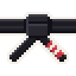
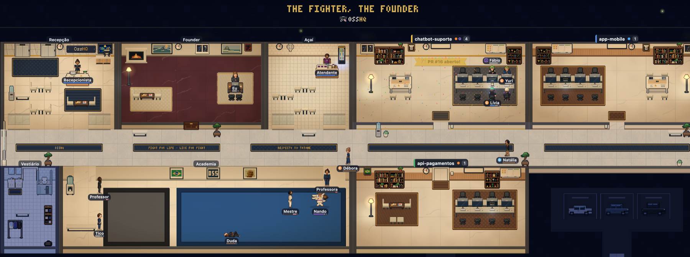
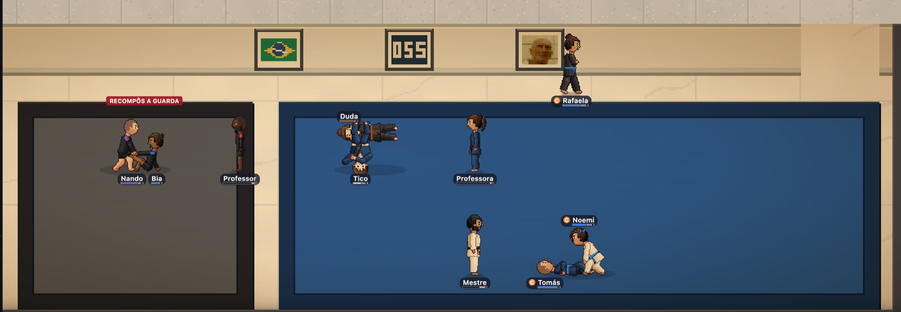
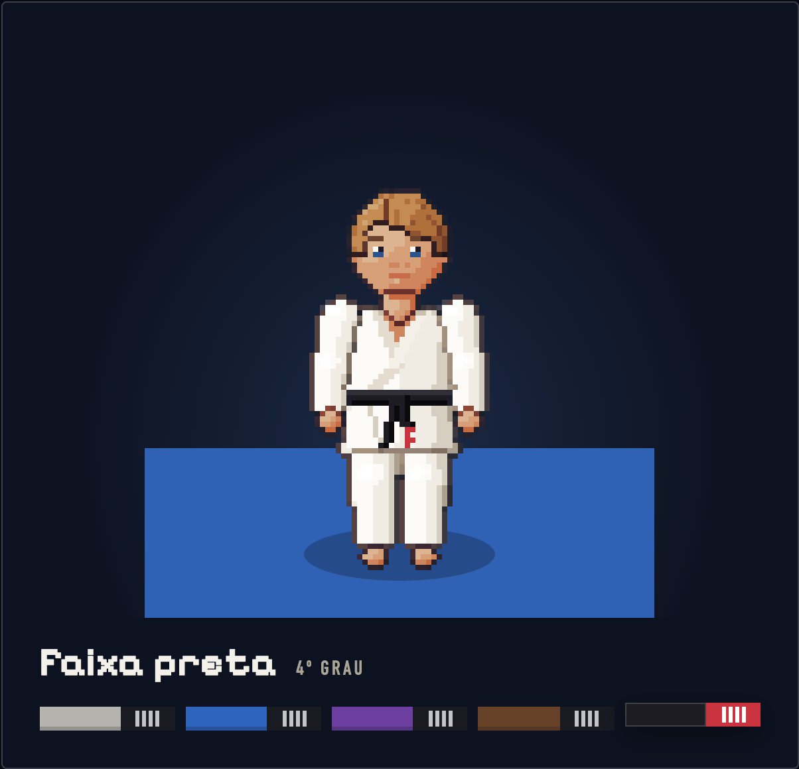

<p align="center">
  
</p>

<h1 align="center">OssHQ</h1>

<p align="center">
  <b>The pixel-art HQ for your AI agents.</b><br />
  Every Claude Code and Codex session becomes an athlete: it works at the desk, trains jiu-jitsu when idle and earns
  its belt with the work it delivers.
</p>

<p align="center"><a href="README.md">Português</a> · <b>English</b></p>

<p align="center">
  
</p>

## Install

**Through your agent, the easiest way.** Paste this into Claude Code (in the terminal, in VS Code or in the app) or into
Codex. It runs the official installer and tells you what was set up:

```text
Install OssHQ on my machine with the official installer (no sudo, for my user):

curl -fsSL https://github.com/jvttrindade/osshq/releases/latest/download/install.sh | sh

The installer's output already says the HQ address, what got connected (Claude Code and Codex) and, if needed, the line to add to PATH: no need to run anything else to check.
At the end, sum that up for me and remind me to run /reload-plugins in the Claude Code sessions that were already open and, if I use Codex, to approve the OssHQ hooks in /hooks.
```

The agent asks your permission to run the command, and that's it.

**Or from the terminal:**

```sh
curl -fsSL https://github.com/jvttrindade/osshq/releases/latest/download/install.sh | sh
```

The HQ opens at **http://localhost:4747**. Open Claude Code or Codex in any project and watch your agent walk in.

**Needs:** macOS 13.5 or newer (Apple Silicon or Intel) or Linux (x64 or arm64), and Claude Code (2.1.287 or newer) or
Codex.
Node.js ships inside the app: no npm, git or Docker.

## What you get

- **One room per project, one athlete per agent.** See at a glance who is working, who finished and who raised a hand
  because they **need you**.
- **Answer from the HQ.** Approve or deny permission requests and send messages to an agent without hunting for the
  right terminal.
- **Your usage, live.** 5-hour and weekly usage for every Claude Code account.
- **The belt is earned.** Every agent starts as a white belt and is promoted by the work it delivers, with stripes
  along the way. Nobody gets a belt as a gift.
- **The Academy.** Idle agents put on the gi and roll on the mat, with IBJJF points, a referee and a bow at the edge of
  the mat. Oss.

<p align="center">
  
  <br /><sub>Idle? Go train. Roll, tap and bow.</sub>
</p>

<p align="center">
  
  <br /><sub>From white to black, stripe by stripe, through the work delivered.</sub>
</p>

## Commands

| Command | What it does |
| --- | --- |
| `osshq` | Starts the HQ if needed and opens it in the browser |
| `osshq status` | Version, address and whether the HQ is up |
| `osshq stop` · `osshq start` | Stops or starts the HQ |
| `osshq update` | Downloads and installs the newest version |
| `osshq setup` | Installs (again) the Claude Code mod and the Codex hooks |
| `osshq mod status` · `osshq codex status` | Checks the mod in each Claude Code account and the Codex hooks |
| `osshq uninstall --sim` | Removes the mod, the hooks, the service and the app (your data stays in `~/.osshq`) |

Settings live in `~/.osshq/osshq.env`, one variable per line (for example `OSSHQ_PORT=4848`).

## What the installer does

1. Downloads the app for your system from this repository's [Releases](../../releases) and checks its SHA-256.
2. Installs it in `~/.osshq/app` and adds the `osshq` command to `~/.local/bin`.
3. Installs the OssHQ mod in each Claude Code account through Claude Code's own `claude plugin` command, and the hooks
   in `~/.codex/hooks.json` (with a backup). Codex runs new hooks only after you approve them in `/hooks`.
4. Registers a login service (LaunchAgent on macOS, systemd user unit on Linux), so the HQ is always on. It listens
   only on `127.0.0.1`.

Running the same command again updates the app and keeps your data.

## Privacy

OssHQ runs on your computer. It reads the session files Claude Code and Codex already write and never sends them
anywhere. It doesn't read your credentials. The only outbound request is the update check against this repository's
releases, every 6 hours; `OSSHQ_UPDATE_CHECK=0` in `~/.osshq/osshq.env` turns it off.

## Feedback

Found a bug or have an idea? [Open an issue](../../issues). This repository hosts the releases, the installer and the
issues; the app's source code is not published here.

## License

OssHQ belongs to T.EDT: the releases published here are free to use, but the code is not open source. The terms are in
[LICENSE](LICENSE), which also ships inside the app; by installing, you accept that license.

OssHQ started from [Habblaud](https://github.com/marmottajr/habblaud) by Márcio Junior (MIT). His notice is at the end
of `LICENSE`, and the other components' notices ship inside the app, in `THIRD_PARTY_NOTICES.md`. The photo of Hélio
Gracie on the Academy wall is by Satorijits, on [Wikimedia Commons](https://commons.wikimedia.org/wiki/File:Helio_Gracie_in_2004.jpg),
under [CC BY-SA 3.0](https://creativecommons.org/licenses/by-sa/3.0/).

<p align="center"><i>Fight for life, live for fight.</i><br />Made by T.EDT · Trindade Educação Tecnológica</p>
